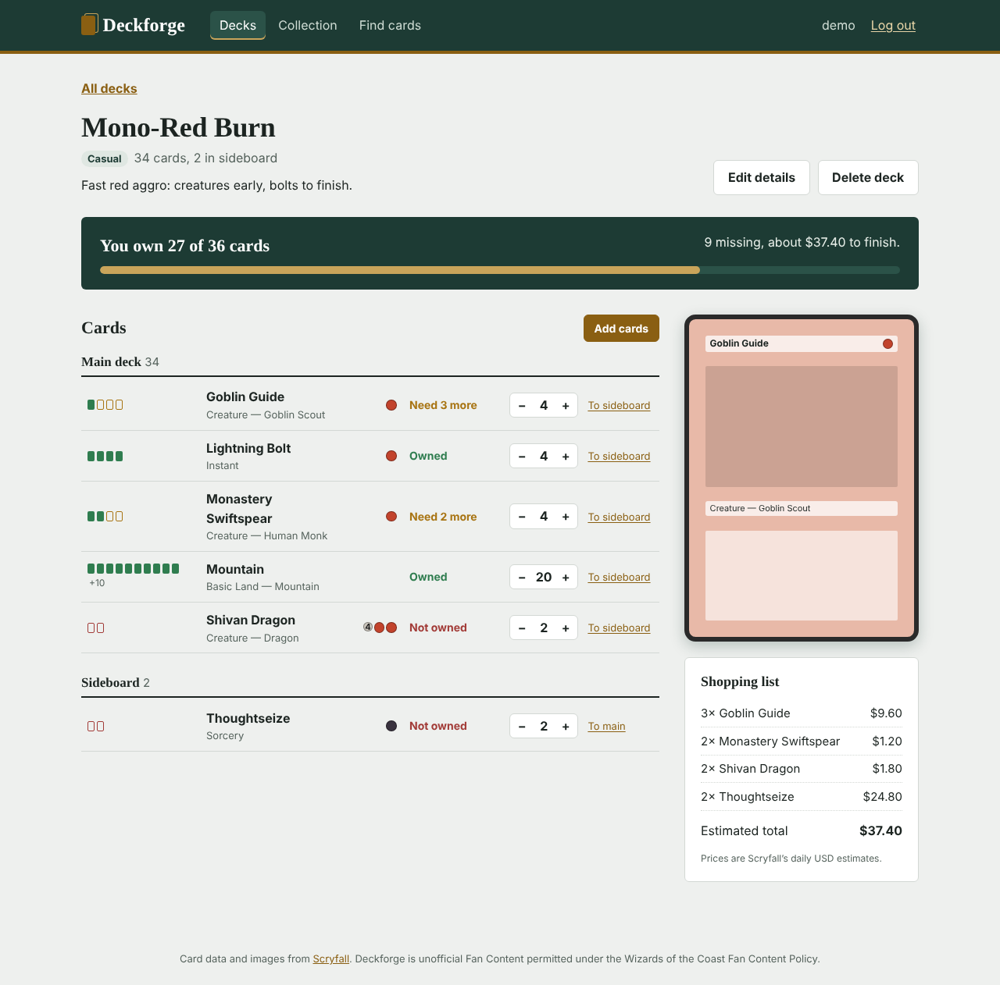
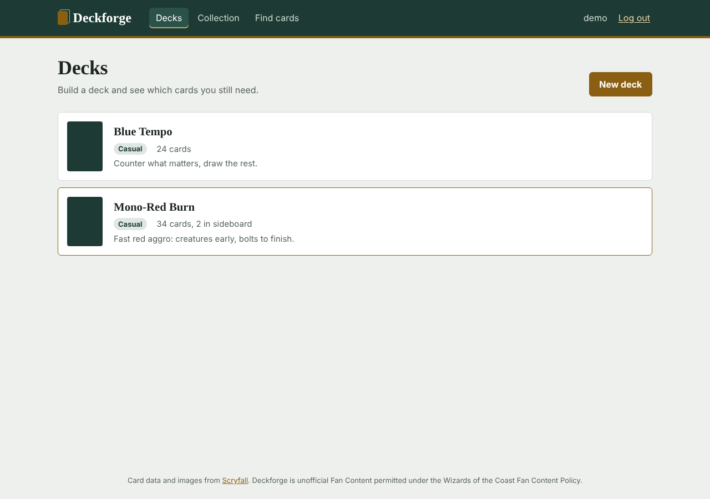
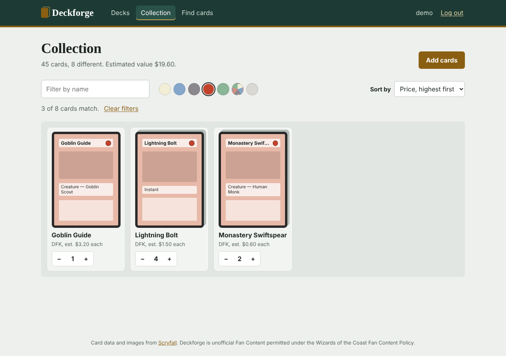
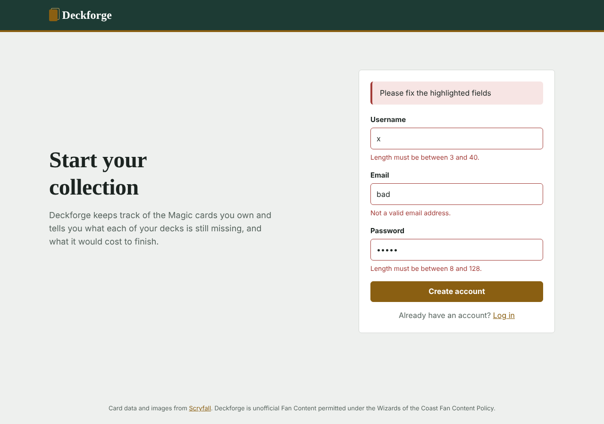

# Deckforge

Deckforge links a Magic: The Gathering player's real card collection to their decks. It shows which cards you own, which you're missing, and roughly what it would cost to finish each deck.

Deck-building sites assume you own every card. Players find out too late that key cards are missing, or they buy duplicates of cards already sitting in a binder. Deckforge solves that by checking every deck against the collection you've recorded.

**Live app:** _not deployed yet. See [Deployment](#deployment)._



> Screenshots are from offline mode (`SCRYFALL_MODE=fake`), which draws simple card frames. With the live Scryfall API you see the real card images.

## Features

- **Accounts:** sign up, log in with username or email, and log out. Passwords are hashed with bcrypt and sessions use JWT. A refresh keeps you logged in; an expired or tampered token sends you back to the login page.
- **Card search:** search all Magic cards on Scryfall by name or [Scryfall syntax](https://scryfall.com/docs/syntax) (`t:dragon`, `c:red`). Results show how many copies you already own, and "Show more cards" loads the next page.
- **Collection:** add cards, change how many copies you own, and remove cards. You can filter by name or color, sort by name, price, copies or date added, and move between pages. The page header shows totals and estimated value for the whole collection.
- **Decks:** create, rename, re-format and delete decks. Add cards to the main deck or the sideboard, change quantities, and move cards between the two.
- **Owned vs missing:** each copy of a card in a deck is shown as a slot, filled if you own it and hollow if you don't. A progress bar shows how complete the deck is, and a shopping list prices the missing cards.
- **Privacy:** you can only see and change your own collection and decks. Requests for someone else's data get a 403.
- **Responsive layout:** works on phones, with keyboard focus styles and screen-reader labels.

| Decks | Collection with filters | Signup validation |
| --- | --- | --- |
|  |  |  |

## Tech stack

| Layer | Tools |
| --- | --- |
| Backend | Python 3.11+, Flask 3, Flask-SQLAlchemy, Flask-Migrate (Alembic), Flask-JWT-Extended, Flask-Bcrypt, Flask-CORS, Flask-Limiter, Marshmallow |
| Database | SQLite in development, PostgreSQL in production |
| External API | [Scryfall](https://scryfall.com/docs/api) for card data, images and prices (free, no key) |
| Frontend | React 19, React Router 7, Vite 7, plain CSS with custom properties |
| Quality | pytest (37 tests, Scryfall mocked with `responses`), ESLint with React Hooks rules |
| Deployment | Render (API and Postgres, via `render.yaml`), Vercel (frontend, via `client/vercel.json`) |

## Getting started

You need **Python 3.11+** and **Node 20+**.

### 1. Clone

```bash
git clone https://github.com/LarryPursuit/DeckForge.git
cd DeckForge
```

### 2. Start the API (terminal 1)

```bash
cd server
python3 -m venv .venv
source .venv/bin/activate        # Windows: .venv\Scripts\activate
pip install -r requirements.txt

cp .env.example .env
# Open .env and set JWT_SECRET_KEY. Generate one with:
python3 -c "import secrets; print(secrets.token_urlsafe(48))"

export FLASK_APP=wsgi.py         # Windows PowerShell: $env:FLASK_APP="wsgi.py"
flask db upgrade                 # create the tables
python3 seed.py                  # optional demo data (re-running resets only the demo account)
flask run --port 5555
```

The API refuses to start without a `JWT_SECRET_KEY` of at least 32 characters, so a weak or missing secret can't slip into production.

### 3. Start the frontend (terminal 2)

```bash
cd client
npm install
npm run dev
```

Open http://localhost:5173. Log in as **demo / password123** if you ran the seed, or create an account. Vite proxies `/api` to Flask on port 5555, so no CORS setup is needed locally.

### Offline mode

Set `SCRYFALL_MODE=fake` in `server/.env` to work without internet. Search then uses 16 built-in cards, and the seed script works offline.

### Environment variables

`server/.env` (copy from `server/.env.example`; never commit it):

| Variable | Required | Purpose |
| --- | --- | --- |
| `JWT_SECRET_KEY` | yes | Signs login tokens. At least 32 random characters. |
| `DATABASE_URL` | no | Defaults to SQLite (`server/instance/deckforge.db`). Use a Postgres URL in production. |
| `CORS_ORIGINS` | no | Comma-separated frontend URLs allowed to call the API. Default `http://localhost:5173`. |
| `SCRYFALL_USER_AGENT` | no | Identifies the app to Scryfall, as their API rules require. Put your contact email in it. |
| `SCRYFALL_MODE` | no | `live` (default) or `fake` for offline mode. |
| `JWT_HOURS` | no | How long a login lasts, in hours. Default 8. |
| `AUTH_RATE_LIMIT` | no | Login and signup attempts allowed per IP. Default `10 per minute`. |
| `TRUST_PROXY` | no | Set to `1` behind a proxy (Render) so rate limits see the real client IP. |

`client/.env.local` (production builds only): `VITE_API_URL`, the full URL of the deployed API.

## Running the tests

```bash
cd server
python3 -m pytest         # 37 tests
cd ../client
npm run lint              # ESLint, no warnings
```

The tests cover signup validation, login, protected routes, token errors, the Scryfall cache and required headers, rate-limit (429) handling, collection upserts, filtering and pagination, deck CRUD, the owned-vs-missing calculation, and users being blocked from each other's data. Scryfall is mocked, so the tests never call the real API.

## API reference

Every route lives under `/api`. All routes except signup, login and health need the header `Authorization: Bearer <token>`. Errors come back as JSON: `{ "error": "message", "fields": { "name": ["problem"] } }`.

### Auth

| Method | Route | Body | Returns |
| --- | --- | --- | --- |
| POST | `/api/signup` | `{ username, email, password }` | `201 { token, user }`; `400` invalid fields; `409` taken username or email; `429` too many attempts |
| POST | `/api/login` | `{ username, password }` (username or email) | `200 { token, user }`; `401` wrong credentials; `429` too many attempts |
| GET | `/api/me` | | `{ user, stats: { unique_cards, total_cards, decks } }` |

### Cards (read-only, from Scryfall)

| Method | Route | Notes |
| --- | --- | --- |
| GET | `/api/cards/search?q=bolt&page=1` | Proxies Scryfall search, caches every result, adds `owned` per card. Returns `{ cards, has_more, total, page }`. |
| GET | `/api/cards/:id` | One card. Served from the cache when under 24 hours old, otherwise refreshed from Scryfall. |

### Collection (belongs to the user)

| Method | Route | Notes |
| --- | --- | --- |
| GET | `/api/collection` | Query params: `q` (name contains), `color` (`W` `U` `B` `R` `G`, `C` colorless, `M` multicolor), `sort` (`name` `price` `quantity` `recent`), `page`, `per_page` (max 100). Returns `{ items, pagination, unique_cards, total_cards, estimated_value }`. |
| POST | `/api/collection` | `{ card_id, quantity? }`. Adds a card; if you already own it, the quantity goes up instead (`200`). |
| PATCH | `/api/collection/:id` | `{ quantity }`, from 1 to 999 |
| DELETE | `/api/collection/:id` | `204` |

### Decks (belong to the user)

| Method | Route | Notes |
| --- | --- | --- |
| GET | `/api/decks` | Your decks, most recently updated first |
| POST | `/api/decks` | `{ name, format?, description? }`. Format is one of `casual` `standard` `pioneer` `modern` `commander` `pauper`. |
| GET | `/api/decks/:id` | The deck with every card's `need`, `have`, `missing` and `status`, plus `totals` (owned count, percent, `missing_cost`) |
| PATCH | `/api/decks/:id` | Any of `{ name, format, description }` |
| DELETE | `/api/decks/:id` | `204`; also removes its cards |
| POST | `/api/decks/:id/cards` | `{ card_id, quantity?, board? }` (`main` or `side`). Adding the same card again raises its quantity. |
| PATCH | `/api/decks/:id/cards/:deck_card_id` | `{ quantity?, board? }`. Moving to a board that already has the card merges the two rows. |
| DELETE | `/api/decks/:id/cards/:deck_card_id` | Returns the updated deck |

Asking for another user's collection item or deck returns **403**. Asking for one that doesn't exist returns **404**.

## How it's built

### Data model

```
User ─┬─< CollectionItem >── Card      (Card rows are cached from Scryfall)
      └─< Deck ─< DeckCard >── Card
```

- **User:** username and email (both unique), plus a bcrypt password hash.
- **Card:** keyed by Scryfall's own id. Stores name, set, type, mana cost, colors, image URLs, USD price and `updated_at` (cache age).
- **CollectionItem:** the user's copies of a card. A unique constraint on `(user_id, card_id)` means one row per card, with a quantity.
- **Deck:** belongs to a user; has a name, format and notes.
- **DeckCard:** a card in a deck, with a quantity and a board (`main` or `side`). Unique on `(deck_id, card_id, board)`.

### Project layout

```
deckforge/
├── server/
│   ├── app/
│   │   ├── __init__.py       app factory, error handlers, secret check
│   │   ├── config.py         settings read from environment variables
│   │   ├── models.py         SQLAlchemy models
│   │   ├── schemas.py        Marshmallow validation for request bodies and query params
│   │   ├── scryfall.py       Scryfall client: headers, throttling, caching, offline mode
│   │   ├── utils.py          get_owned_or_404(): the single ownership check
│   │   └── routes/           auth, cards, collection, decks blueprints
│   ├── migrations/           Alembic migrations
│   ├── tests/                pytest suite
│   ├── seed.py               demo data
│   └── wsgi.py               entry point for flask run and gunicorn
├── client/
│   └── src/
│       ├── api.js            apiFetch(): adds the token, parses errors, handles 401
│       ├── context/          AuthProvider and useAuth()
│       ├── components/       Layout and route guards, CardSearch, CardImage, ManaCost, Pagination
│       ├── pages/            Auth, Decks, DeckDetail, Collection, Search, NotFound
│       └── styles.css
├── render.yaml               Render blueprint for the API and database
└── docs/screenshots/
```

### Authentication and authorization

- **Why JWT:** the frontend (Vercel) and API (Render) live on different domains. A bearer token avoids cross-site cookie problems and keeps the API stateless.
- **Passwords:** hashed with bcrypt and never returned by any route. Login gives the same error for a wrong username and a wrong password, so the API doesn't reveal which accounts exist. Passwords are capped at bcrypt's 72-byte limit.
- **Rate limiting:** Flask-Limiter allows 10 login or signup attempts per minute per IP address, which slows down password guessing.
- **Ownership:** every collection and deck route loads rows through `get_owned_or_404()`, which returns 404 if the row doesn't exist and 403 if it belongs to someone else. Deck-card routes also confirm the card row belongs to the deck in the URL.
- **Frontend guards:** `ProtectedRoute` redirects logged-out users to the login page and returns them to the page they asked for after they log in. `GuestRoute` keeps logged-in users away from the login and signup pages. Nav links and the username only appear when you're logged in.
- **Expired tokens:** `apiFetch()` fires a logout event on any 401, so the app returns to the login page with a message instead of showing broken pages.
- **Known trade-off:** the token is kept in `localStorage`, which XSS can reach. React escapes all card text and nothing is rendered as raw HTML. Moving to httpOnly cookies is listed under future work.

### Working with Scryfall

- All card data goes through Flask; the browser never calls Scryfall directly.
- Each request sends the `User-Agent` and `Accept` headers Scryfall requires.
- Search is throttled to Scryfall's limit of 2 requests per second, and the React search box waits 400 ms after typing stops.
- An HTTP 429 from Scryfall becomes a clear "try again" message, never a silent retry.
- Card ids must be Scryfall UUIDs, so user input can't change which Scryfall URL gets called.
- Every card Scryfall returns is upserted into the `cards` table. Deck and collection pages read only from that cache. Outside of search, Scryfall is called only when you add a card whose cached copy is more than 24 hours old.

### Owned vs missing

`deck_status()` in `server/app/routes/decks.py` compares each deck row with the user's collection. Owned copies are shared between the main deck and the sideboard, with the main deck claiming them first, so four owned Lightning Bolts can't count as four in each.

## Deployment

**API and database on Render:**
1. In the Render dashboard choose **New > Blueprint** and select this repo. `render.yaml` creates the web service and a free Postgres database, and generates `JWT_SECRET_KEY`.
2. When prompted, set `CORS_ORIGINS` to your Vercel URL and `SCRYFALL_USER_AGENT` to `Deckforge/1.0 (your email)`.
3. Each deploy runs `flask db upgrade`, then starts the app with `gunicorn wsgi:app`.

**Frontend on Vercel:**
1. Import the repo and set the root directory to `client`.
2. Add the environment variable `VITE_API_URL=https://<your-render-service>.onrender.com`.
3. `client/vercel.json` sends every route to `index.html`, so refreshing `/decks/3` works.

## Future improvements

- Deck legality checks for each format (60-card minimum, 4-copy limit, Commander rules)
- Paste a deck list to import it, and export decks as text
- Mana curve and color breakdown charts on each deck
- Match cards by name across printings, so any printing you own counts
- httpOnly cookie sessions with CSRF protection
- Public, read-only deck links to share with friends

## Credits

Card data and images from [Scryfall](https://scryfall.com). Deckforge is unofficial Fan Content permitted under the Wizards of the Coast Fan Content Policy. Not approved or endorsed by Wizards. Portions of the materials used are property of Wizards of the Coast. ©Wizards of the Coast LLC.
